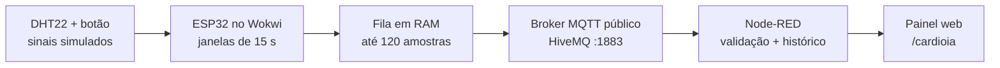

# CardioIA — Monitoramento de Sinais Vitais com IoT

> Protótipo acadêmico de **monitoramento de sinais simulados** com ESP32, Wokwi, MQTT e Node-RED. O projeto demonstra coleta local, comportamento durante falhas de conexão e visualização de dados em um painel web.

<p align="center">
  <a href="https://wokwi.com/projects/478271631471196161">Simulação da Parte 1</a> ·
  <a href="https://wokwi.com/projects/479690560422145025">Simulação da Parte 2</a> ·
  <a href="#como-executar">Como executar</a>
</p>


## Sobre o projeto

O **CardioIA** reproduz, em ambiente simulado, etapas comuns de uma solução de Internet das Coisas (IoT) para acompanhamento de sinais vitais. Um **ESP32** recebe uma temperatura de um sensor **DHT22** e cliques de um **botão**, que representam pulsos cardíacos. Na segunda parte, calcula uma frequência cardíaca simulada em batimentos por minuto (BPM), transmite as amostras por **MQTT** e as apresenta em uma interface web.

O material está dividido em duas implementações complementares:

- **Parte 1 — Edge e resiliência offline:** simula alternância entre conexão e desconexão, armazena temporariamente leituras na memória do ESP32 e demonstra a recuperação dos registros via Monitor Serial.
- **Parte 2 — Telemetria e visualização:** conecta o ESP32 simulado a um broker MQTT público e disponibiliza histórico, alertas e indicadores por meio de um fluxo Node-RED.

**Importante:** embora o projeto se chame *CardioIA*, os arquivos atuais **não implementam um modelo de inteligência artificial**, nem medem batimentos cardíacos reais. Os pulsos são cliques manuais; os valores e limites são didáticos. **Não utilize o sistema para diagnóstico, monitoramento clínico ou decisões médicas.**

## Funcionalidades

| Parte | Recurso | Como funciona |
| --- | --- | --- |
| 1 | Coleta local | Lê a temperatura a cada 2 segundos e conta cliques no botão. |
| 1 | Simulação de falha | Alterna uma variável que representa o estado da conexão a cada 10 segundos. |
| 1 | Buffer offline | Armazena até **50 registros** em RAM durante o período simulado de desconexão. |
| 1 | Recuperação | Reproduz os registros armazenados no Monitor Serial quando a conexão simulada retorna. |
| 2 | Cálculo de BPM | Conta os cliques em janelas de **15 segundos** e converte a contagem para BPM. |
| 2 | MQTT | Publica mensagens JSON no broker `broker.hivemq.com`, porta `1883`. |
| 2 | Fila de envio | Mantém até **120 amostras** em RAM quando o envio não está disponível. |
| 2 | Painel web | Mostra frequência simulada, temperatura, histórico e situação dos limites. |
| 2 | Alertas | Sinaliza valores **acima de 120 BPM** ou **acima de 38 °C** e temperatura indisponível. |
| 2 | Dados antigos | Exibe um aviso quando a última coleta estimada tem mais de **35 segundos**. |

## Tecnologias utilizadas

- **ESP32 / Arduino (C++):** leitura dos sensores, cálculo de BPM, controle de tarefas e envio MQTT.
- **Wokwi:** simulação do ESP32, do DHT22 e do botão.
- **DHT22:** sensor de temperatura simulado.
- **Wi-Fi:** conexão do ESP32 à rede virtual `Wokwi-GUEST` na Parte 2.
- **MQTT 3.1.1 / HiveMQ Public Broker:** transporte das mensagens de telemetria.
- **Node-RED:** assinatura do tópico MQTT, validação das mensagens, armazenamento do histórico em memória e endpoints HTTP.
- **HTML, CSS e JavaScript:** painel servido pelo próprio Node-RED, sem dependência de um pacote de dashboard adicional.

### Arquitetura da Parte 2



Na **Parte 1**, a perda de conectividade é apenas simulada por uma variável do firmware: não há comunicação real com um servidor ou broker. Na **Parte 2**, o MQTT é real dentro da simulação, e a fila em RAM reduz a perda de amostras em interrupções temporárias, sem garantir entrega ponta a ponta.

## Estrutura do repositório

```text
CardioIA-Fase-3/
├── README.md                       # Este guia
├── README.txt                      # Orientações originais do projeto
├── links.txt                       # Links dos projetos no Wokwi
├── Parte1/
│   ├── sketch.ino                  # Coleta local e falha simulada de rede
│   ├── diagram.json                # Circuito no Wokwi
│   ├── libraries.txt               # Bibliotecas da Parte 1
│   └── Relatorio-Parte-1.docx      # Relatório técnico
└── Parte2/
    ├── fluxo-cardioia.json         # Fluxo importável no Node-RED
    ├── Painel-teste-MQTT.png       # Captura de um teste com dados sintéticos
    ├── Relatorio-Parte-2.docx      # Relatório técnico
    └── Wokwi/
        ├── sketch.ino              # Coleta, fila e publicação MQTT
        ├── diagram.json            # Circuito no Wokwi
        └── libraries.txt           # Bibliotecas da Parte 2
```

## Pré-requisitos

Para executar a **Parte 1**, basta ter acesso ao [Wokwi](https://wokwi.com/) em um navegador.

Para executar o sistema completo da **Parte 2**, são necessários:

1. Um navegador com acesso ao [Wokwi](https://wokwi.com/).
2. [Node.js](https://nodejs.org/) e [Node-RED](https://nodered.org/) instalados no computador.
3. Conexão de rede que permita acesso ao broker `broker.hivemq.com` na porta TCP **1883**.
4. Bibliotecas do sketch da Parte 2: **DHT sensor library**, **Adafruit Unified Sensor** e **PubSubClient** (listadas em `Parte2/Wokwi/libraries.txt`).

> Os nós utilizados pelo fluxo já fazem parte da instalação padrão do Node-RED. Não é necessário instalar `node-red-dashboard` para visualizar esta interface.

## Como executar

### 1. Parte 1 — Coleta local e armazenamento offline

1. Acesse o [projeto da Parte 1 no Wokwi](https://wokwi.com/projects/478271631471196161).
2. Inicie a simulação e abra o **Serial Monitor**, configurado para **115200 baud**.
3. Clique no botão para gerar pulsos e altere a temperatura do DHT22 para testar as leituras.
4. Observe as mensagens de conexão, desconexão e recuperação exibidas no terminal.
5. Durante o estado offline simulado, as leituras ficam em RAM. Quando o estado volta a online, o sketch as imprime na ordem em que foram armazenadas.

**Observação:** os registros `☁️ [NUVEM]` e `☁️ [ENVIADO PARA NUVEM]` nesta parte são **mensagens no Serial Monitor**, e não envios reais para a nuvem. A memória comporta 50 registros; novas leituras são descartadas se ela estiver cheia.

### 2. Parte 2 — Instalar e iniciar o Node-RED

Caso ainda não tenha o Node-RED instalado, após instalar o Node.js, execute no terminal:

```bash
npm install -g node-red
```

Inicie o servidor:

```bash
node-red
```

Abra o editor em:

```text
http://localhost:1880
```

No editor do Node-RED:

1. Acesse **Menu → Import**.
2. Selecione o arquivo `Parte2/fluxo-cardioia.json`.
3. Importe o fluxo e clique em **Deploy**.
4. Confira se o nó **Telemetria MQTT** mostra o estado **connected**.

Se a conexão não for estabelecida, verifique o acesso de saída à porta **1883** e as configurações do broker.

### 3. Parte 2 — Iniciar o ESP32 no Wokwi

1. Abra o [projeto da Parte 2 no Wokwi](https://wokwi.com/projects/479690560422145025).
2. Confira se a simulação utiliza os arquivos desta entrega: `Parte2/Wokwi/sketch.ino` e `Parte2/Wokwi/diagram.json`. Se estiver montando uma cópia, substitua o código e o circuito pelos arquivos fornecidos.
3. No **Library Manager**, adicione as bibliotecas listadas em `Parte2/Wokwi/libraries.txt`.
4. Inicie a simulação e abra o **Serial Monitor** em **115200 baud**.
5. Aguarde a mensagem `MQTT conectado`. O primeiro registro é coletado após aproximadamente **15 segundos**.

O sketch utiliza `Wokwi-GUEST`, que é uma rede própria do simulador. Para executar em uma placa física, é preciso adaptar a configuração de Wi-Fi e validar o comportamento do hardware.

### 4. Abrir o painel

Com o Node-RED e a simulação ativos, acesse:

**http://localhost:1880/cardioia**

O painel exibe:

- **Estado da última leitura**, com indicação de alerta ou dados antigos;
- **BPM simulado** e gráfico das últimas **60 amostras**;
- **Temperatura simulada** e medidor de 30 a 45 °C;
- **Horário estimado da coleta** e número de sequência da amostra.

A página consulta os dados do Node-RED a cada **2 segundos**. Os endpoints fornecidos pelo fluxo são `GET /cardioia` (página HTML) e `GET /cardioia/dados` (histórico JSON).

### Exemplo do painel


*Captura incluída no projeto, obtida em um teste com mensagens MQTT sintéticas. Não representa, por si só, validação completa da comunicação ESP32 → broker → painel.*

## Formato da telemetria MQTT

**Broker:** `broker.hivemq.com`  
**Porta:** `1883` (sem TLS)  
**Tópico de publicação e assinatura:**

```text
cardioia/lab-478271631471196161/v1/sinais
```

**Exemplo de mensagem:**

```json
{
  "sessao": "a1b2c3d4",
  "seq": 1,
  "idade_ms": 20,
  "bpm": 72,
  "temp_c": 36.7
}
```

| Campo | Significado |
| --- | --- |
| `sessao` | Identificador gerado ao iniciar o ESP32; diferencia execuções. |
| `seq` | Número sequencial da janela de coleta na sessão. |
| `idade_ms` | Tempo, em milissegundos, entre a coleta e a tentativa de envio. |
| `bpm` | Frequência simulada calculada a partir dos cliques na janela. |
| `temp_c` | Temperatura em °C; pode ser `null` quando a leitura do DHT22 falha. |

O firmware envia mensagens com **MQTT QoS 0**, sem retenção. O Node-RED valida o conteúdo, ignora duplicatas de `sessao` + `seq` e guarda até **60 amostras** no contexto do fluxo.

## Como testar

| Cenário | Ação | Resultado esperado |
| --- | --- | --- |
| Condição normal | Ajuste o DHT22 para **36,7 °C** e produza **18 cliques** em uma janela completa de 15 segundos. | Aproximadamente **72 BPM** e estado dentro dos limites. |
| Alerta de temperatura | Ajuste o DHT22 para **39 °C** e aguarde uma nova janela. | Mensagem de temperatura acima de 38 °C. |
| Alerta de BPM | Produza **31 cliques** em 15 segundos. | Aproximadamente **124 BPM** e alerta de frequência elevada. |
| Recuperação | Retorne a temperatura para 36,7 °C e diminua os cliques. | O alerta é removido após uma nova leitura dentro dos limites. |
| Ausência de dados | Interrompa a simulação por mais de **35 segundos**. | Aviso de dados desatualizados. |

**Cálculo do BPM:**

```text
BPM = (quantidade de pulsos × 60.000) / duração da janela em ms
Exemplo: (18 × 60.000) / 15.000 = 72 BPM
```

Os limites são **estritamente maiores** que 120 BPM e 38 °C. Valores exatamente iguais a esses números não geram alerta. A temperatura do DHT22 e os cliques são simulados; não representam medição de um paciente.

## Limitações e cuidados

- **Sem IA implementada:** o projeto não contém treinamento, inferência, previsão ou classificação por machine learning.
- **Sem sensor cardíaco real:** o botão apenas simula pulsos. O DHT22 simula temperatura do sensor/ambiente, não temperatura corporal validada.
- **Sem garantia de entrega:** MQTT com QoS 0 pode perder mensagens, e o sucesso da publicação não garante o recebimento pelo painel.
- **Dados voláteis:** a fila do ESP32 e o histórico padrão do Node-RED estão em memória. Reinicializações podem apagar as amostras.
- **Fila limitada:** a Parte 2 comporta 120 janelas (cerca de 30 minutos); se encher, novas amostras são descartadas.
- **Broker público:** a conexão MQTT de demonstração não utiliza autenticação nem criptografia. **Nunca transmita dados pessoais ou de saúde reais por esse tópico.**
- **Colisões de tópico:** várias instâncias usando o mesmo tópico podem misturar os resultados. Para testes independentes, altere o tópico no sketch e no nó MQTT do Node-RED.
- **Dependência local:** o painel funciona enquanto a instância local do Node-RED estiver em execução.
  
## Integrantes

- Estevão Ferreira Santos  RM567522
- Murilo Ferreira Borges  RM567738
- Guilherme Pinheiro Carlsson Cury  RM564011

## Documentação e referências

**Arquivos do projeto:**

- [`Parte1/Relatorio-Parte-1.docx`](Parte1/Relatorio-Parte-1.pdf) — coleta local, falha simulada e memória offline.
- [`Parte2/Relatorio-Parte-2.docx`](Parte2/Relatorio-Parte-2.pdf) — MQTT, fila, painel e roteiro de verificação.
- [`Parte2/fluxo-cardioia.json`](Parte2/fluxo-cardioia.json) — fluxo importável do Node-RED.

**Documentação externa:**

- [Wokwi — Wi-Fi com ESP32](https://docs.wokwi.com/guides/esp32-wifi)
- [Node-RED — Instalação local](https://nodered.org/docs/getting-started/local)
- [HiveMQ — Public MQTT Broker](https://www.hivemq.com/mqtt/public-mqtt-broker/)
- [PubSubClient — API](https://pubsubclient.knolleary.net/api)
- [Node-RED Cookbook — HTTP endpoint](https://cookbook.nodered.org/http/create-an-http-endpoint)

---

**CardioIA · Fase 3** — Projeto acadêmico de simulação e demonstração de conceitos de IoT e monitoramento de sinais.
